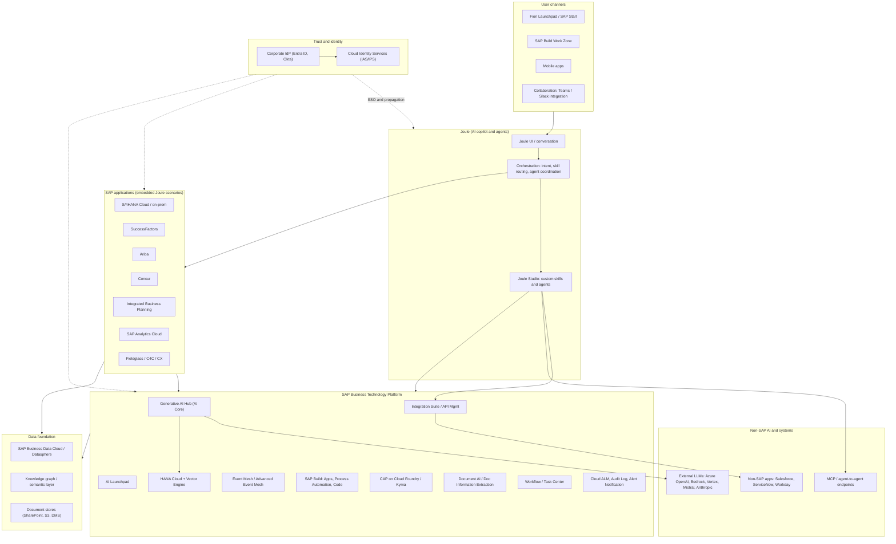
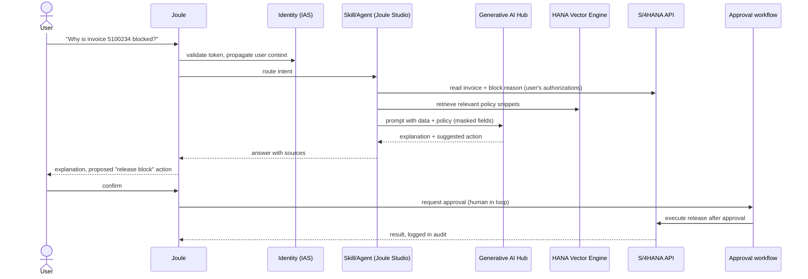
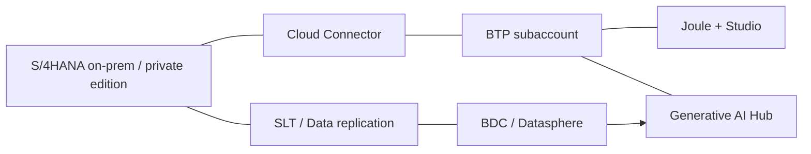
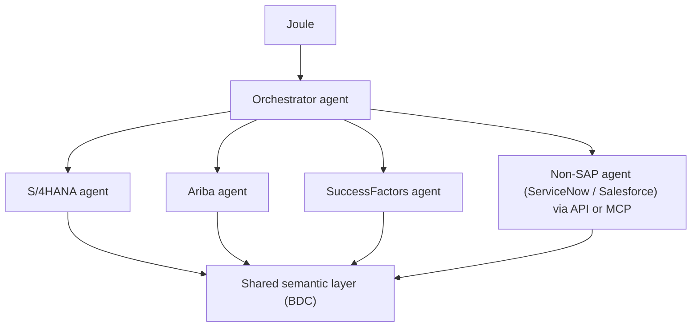

# Ecosystem Architecture: Joule in the SAP and BTP Landscape

Diagrams use Mermaid (renders in GitHub, GitLab, VS Code, Confluence plugins). Product names reflect authoring date **[VERIFY]**.

## 1. Big picture: where Joule sits

**Reading guide:** users enter through a channel; Joule interprets intent and routes to either a standard embedded scenario in an SAP application or a custom skill/agent built in Joule Studio. Custom logic calls BTP services (Generative AI Hub for model access, HANA Vector Engine for grounding, Integration Suite for APIs, Event Mesh for triggers). Identity is propagated end to end so data access follows the user's own authorizations.

## 2. Request flow: a grounded question with a governed action

## 3. Landscape variants

### 3.1 Public cloud (RISE with SAP / S/4HANA Cloud Public)
- Joule embedded scenarios available as delivered by SAP release **[VERIFY per release]**.
- Extensions via side-by-side BTP only (clean core), key-user extensibility for light changes.
- Identity: IAS with corporate IdP federation.

### 3.2 Private cloud / on-premise S/4HANA

- Expose APIs via OData/REST through Cloud Connector and API Management.
- Some Joule scenarios may require specific releases or add-ons **[VERIFY]**.
- Prefer event-based change feed or replication for analytical questions; use live APIs for transactional context.

### 3.3 Multi-system / heterogeneous landscape

## 4. Layered view (for architecture decision records)

| Layer | Components | Decision owner |
|---|---|---|
| Experience | Joule UI, Work Zone, Teams/Slack | Product owner |
| Orchestration | Joule orchestration, Joule Studio agents, workflows | Solution architect |
| Intelligence | Generative AI Hub models, SAP foundation models, external LLMs, embeddings | AI architect |
| Knowledge | HANA Vector, BDC semantic models, document grounding | Data architect |
| Integration | Integration Suite, API Mgmt, Event Mesh, Cloud Connector | Integration architect |
| Trust | IAS/IPS, authorization, audit log, DPI, key management | Security architect |
| Operations | Cloud ALM, AI Launchpad, alerting, cost monitoring | Platform lead |

## 5. Reference architecture A: "Standard-first" (lowest effort)
Use embedded Joule in S/4HANA, SuccessFactors, Ariba, Concur. Add Work Zone as one entry point. Only configuration, enablement and training.
**Use when:** client wants fast value and scenario coverage matches pain points.

## 6. Reference architecture B: "Extended" (custom skills/agents)
A plus Joule Studio skills/agents calling S/4 APIs, Integration Suite flows, Workflow approvals, Generative AI Hub for text tasks, HANA Vector for document grounding.
**Use when:** process-specific automation not covered by standard.

## 7. Reference architecture C: "Data-driven" (analytics and cross-system)
B plus Business Data Cloud/Datasphere for harmonised data, SAC for planning, predictive/foundation models for forecasting or classification.
**Use when:** questions span SAP and non-SAP data, or need history and trends.

## 8. Reference architecture D: "Multi-AI hybrid"
C plus external LLMs through Generative AI Hub, MCP/agent interoperability with third-party agents. See `04-multi-ai/multi-ai-patterns.md`.
**Use when:** client has an enterprise AI platform standard or needs a specific model capability or residency.

## 9. Environment topology

| Env | Purpose | Notes |
|---|---|---|
| Sandbox/Trial | Demos, exploration | No client data |
| Dev | Skill/agent building | Synthetic or masked data |
| QA/Test | UAT, evaluation sets | Production-like authorizations |
| Prod | Live | Change control, monitoring, budgets/alerts |

Transport with Cloud Transport Management; keep prompts, skill definitions and evaluation sets in source control.

## 10. Non-functional targets (starting points, tune per client)

| Aspect | Starting target |
|---|---|
| Answer latency (simple Q&A) | < 5 to 8 s p90 |
| Availability | Aligned to underlying SAP cloud SLAs |
| Answer quality | ≥ 90% accepted on curated test set before go-live |
| Security | 0 cross-role data leakage in test |
| Cost | Monthly consumption alert at 80% of budget |
