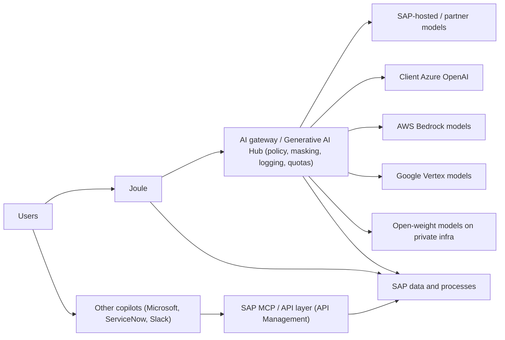

# Multi-AI Patterns: Using Joule and SAP AI with Other Models and Platforms

## 1. Why multi-AI
Clients often have an enterprise AI standard (Azure OpenAI, AWS Bedrock, Google Vertex, an Anthropic or Mistral contract, or on-prem open models), data-residency rules, or specific capability needs (long documents, vision, code). SAP's strategy is to be model-flexible through Generative AI Hub while keeping business context and security in SAP.

## 2. Integration options

| Option | Description | Pros | Cons |
|---|---|---|---|
| O1. Joule only (SAP-managed models) | Use embedded Joule as delivered | Fastest, supported by SAP | Limited model choice |
| O2. Generative AI Hub with selectable models | Call third-party LLMs hosted/proxied through AI Core (model availability **[VERIFY]**) | Governance, one API, SAP-aligned security | Catalogue limited to supported models |
| O3. Bring your own model endpoint | Client's Azure/Bedrock/Vertex endpoint called from CAP/Studio via Destination service | Uses client AI contract, own residency | You own security, cost and ops |
| O4. External agent platform calls SAP | Third-party agent/copilot (Microsoft Copilot, ServiceNow, custom) calls SAP APIs / MCP servers | Fits users where they work | Authorization and audit must be rebuilt carefully |
| O5. Joule calls external agents | Joule orchestrates third-party agents/tools through APIs or agent protocols **[VERIFY]** | One front door | Protocol maturity varies |
| O6. Federated "AI mesh" | Orchestrator routes tasks to best model/agent by cost, sensitivity, capability | Optimal, vendor-neutral | Most complex, needs governance |

## 3. Reference diagram

## 4. Model selection guide

| Task | Preferred characteristics | Notes |
|---|---|---|
| Q&A on structured data | Strong tool/function calling, low latency | Let tools compute; model narrates |
| Long contract/document analysis | Large context window, good extraction | Chunk plus cite; check residency |
| Invoice/PO/image extraction | Vision capability or dedicated document service | Validate with rules |
| Code (ABAP, CAP) | Code-tuned model, safe policy | IP/privacy policy first |
| Sensitive HR/finance | Residency-compliant, private deployment, masking | Possibly open-weight on private infra |
| High-volume simple classification | Small/fast model or classical ML | Cost-driven |
| Multilingual | Verified language coverage | Test per language |

## 5. Decision tree

1. Does standard Joule cover it? → Use it (O1).
2. Need custom logic with SAP governance? → Joule Studio / CAP + Generative AI Hub (O2).
3. Client mandates its own model contract or region? → O3 with a gateway layer.
4. Users live in another copilot? → O4 (expose governed SAP APIs/MCP).
5. Need cross-vendor workflow? → O5/O6 with strict orchestration and logging.

## 6. Guardrails for non-SAP models
- Approved-model register (vendor, version, region, data terms, security review).
- Masking/anonymisation before external calls; no raw PII unless approved.
- Same authorization enforcement as Joule: the tool layer checks the user's rights.
- Central logging independent of the model vendor.
- Evaluation gate for each model change (see governance).
- Contractual: no training on client data, retention limits, breach notification.
- Exit plan: prompts/tools abstracted behind an interface so models can be swapped.

## 7. Interoperability notes **[VERIFY all against current SAP and standards status]**
- **MCP (Model Context Protocol):** standard way for agents to discover and call tools. Useful to expose SAP business capabilities as tools to non-SAP agents, and to let SAP agents use external tools.
- **Agent-to-agent protocols:** emerging; plan for them but do not make production commitments before SAP confirms support.
- **OpenAPI/OData:** the dependable baseline; wrap SAP APIs with API Management for throttling and auth.

## 8. Example hybrid scenarios
| ID | Scenario | Pattern |
|---|---|---|
| HYB-01 | Microsoft Copilot user asks about open POs; MCP/API layer returns data under user's identity | O4 |
| HYB-02 | ServiceNow incident agent calls an SAP agent to check the order state, then updates the ticket | O5 |
| HYB-03 | Contract analysis through the client's Azure OpenAI deployment, results written to Ariba via API | O3 |
| HYB-04 | Private open-weight model summarises HR cases to keep data on-prem, orchestrated via Studio | O3/O6 |
| HYB-05 | Vision model reads delivery-note photos from drivers, creates goods-receipt drafts in S/4 | O2 + P7 |
| HYB-06 | Cost-based router: simple tasks to small model, complex to larger | O6 + P14 |
| HYB-07 | Salesforce case agent queries S/4 for delivery status and entitlement | O4 |
| HYB-08 | Teams/Slack bot front-ends Joule for approvals | Channel integration |
| HYB-09 | Data science team trains forecasting model in AI Core, Joule explains outputs | P8 |
| HYB-10 | Code assistant of the client's choice reviews ABAP exported through approved pipeline | P10 |
