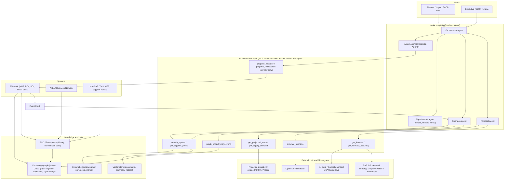

# Demand Forecasting and Shortage Prediction: Knowledge Graphs, MCP and Related AI Concepts on SAP

Status: DRAFT v0.2. Updated 2026-11-23 after the evidence review in `_research/forecasting-kg-mcp-evidence.md`. Statements still marked **[VERIFY]** remain open in `07-sdlc-guide/05-verify-register.md`. Business-value evidence is in `08-value-cases/`.

## 0. What the evidence changed in this design (read first)

1. **Standard first applies here.** SAP IBP already provides demand sensing (daily periodicity; gradient boosting is the current algorithm per SAP documentation, 2026-11), Joule scenario planning (stated generally available, Q3 2026), and an **Exception Management Agent** that investigates alerts and proposes mitigations (GA "underway in a phased approach"; requires SAP-managed Joule). Several supply-chain assistants are "planned for Q4 2026". For an IBP client, Phase 0 must test whether these cover the Shortage Radar before any custom build. Custom work is justified only for gaps (multi-tier exposure beyond IBP, non-SAP data, external signals).
2. **Do not sell the graph as an accuracy multiplier.** Independent comparisons on text corpora show graph grounding helps multi-hop and summarisation questions and is neutral or worse on single-hop lookups (e.g. NQ single-hop F1: vector RAG 64.78 vs KG-triplet GraphRAG 34.28; GraphRAG-Bench fact retrieval: 60.92 vs 60.14). The strongest enterprise-data result (GPT-4 zero-shot accuracy 16% on SQL vs 54% over a KG layer; insurance schema) is a preprint abstract by authors from a KG vendor, and a follow-up reached 72% including 8% "I don't know". **No source tested SAP Knowledge Graph, the HANA Cloud knowledge graph engine, or Joule on SAP data.** Use the graph for relationship questions (shortage root cause, multi-tier exposure), plain governed queries or IBP key figures for single-number lookups, and measure on the client's own questions.
3. **Two different "knowledge graphs".** The HANA Cloud knowledge graph engine (RDF/SPARQL, single compute node) is documented; "SAP Knowledge Graph" (used by Joule Work/Studio, tied to Business Data Cloud) is a separate named capability. No opened source links them. Do not assume one is built on the other.
4. **Forecasts stay in the planning engine.** Evidence favours tuned gradient-boosting and ensembles on intermittent retail data (M5 uncertainty literature), and says time-series foundation models are competitive zero-shot but carry data-leakage caveats (GIFT-Eval authors) and weaknesses on strong trends and short context (Chronos paper). SAP-RPT-1 is a pretrained model for tabular/relational prediction with no fine-tuning; treat it as a candidate for features such as supplier delay risk, benchmarked against a simple baseline, not as the demand forecaster. M4/M5 primary results were not verified.
5. **Customer evidence is thin and unaudited.** SLB with IBP: forecast accuracy "around 50%" to "about 90%" on some business lines and over USD 1 billion inventory savings over four years (SAP-published, no accuracy definition, no counterfactual, cannot separate ML from process change). BRF: data access 33% faster, no accuracy figure. Doehler: about a third of troubleshooting time recovered. No independent supply-chain knowledge-graph detection result with a sample and baseline was found. Treat all as analogues, never promises.
6. **Alerts and citations raise acceptance, not necessarily correctness.** Explanations made people accept AI recommendations "whether or not [they were] correct" (Bansal et al.) and only reduced over-reliance when verification was cheap (Vasconcelos et al.); a citation audit found only 74.5% of citations supported their sentence. Design each alert for one-click verification (the order, stock and supplier record, a recomputable quantity, a short graph path) and sample-audit correctness.
7. **MCP is an untrusted boundary.** Current spec revision 2026-07-28 keeps authorization optional (OAuth 2.1 profile, audience validation, no token passthrough, RFC 9207 issuer check added). Known incidents are tooling vulnerabilities (CVE-2025-6514, CVSS 9.6; CVE-2025-49596, CVSS 9.4) and research demonstrations (tool poisoning, rug pulls); a registry study flagged 833 vulnerable servers of 67,057. SAP's posture: Integration Suite MCP Gateway sample shows principal propagation and approval; MCP access policies in Joule Work Desktop are "disabled by default". Whether SAP's MCP servers implement the MCP OAuth profile was not verified. Dev-time servers (CAP, MDK, ADT) stay out of production data paths.

Related existing material: patterns P3, P5, P8, P11 (`01-architecture/integration-patterns.md`); scenarios SCM-001 to SCM-020, MFG, IND-MFG-01/05, IND-RET-09; autonomy levels in `07-sdlc-guide/01-sdlc-playbook.md`.

---

## 1. The core design thesis

> **Numbers come from deterministic and statistical/ML engines. Relationships come from a knowledge graph. Orchestration and explanation come from the LLM. Tools are exposed through MCP (or equivalent) under the user's authorizations. Actions go through approval.**

Why each piece exists:

| Concept | Job in this solution | What it must NOT do |
|---|---|---|
| Statistical + ML forecasting (IBP, SAC predictive, AI Core, foundation models) | Produce the demand forecast, probability distribution and safety-stock inputs | Be replaced by an LLM guessing numbers |
| Knowledge graph | Hold and traverse relationships: customer-order → material → BOM levels → plant → supplier → lane → PO → shipment; answer "what is affected if X is late" | Become a multi-year "model everything" programme |
| Graph + deterministic propagation | Compute impact of a disruption (which orders, how many days, how much revenue/margin) | Be approximated by LLM reasoning |
| LLM / agents | Interpret the planner's question, call the right tools, read unstructured signals (supplier emails, news, shipping notices), explain results, draft proposals | Calculate, decide autonomously on financial commitments, or bypass authorization |
| MCP / tool layer | Standard, governed interface from agents to SAP functions and data | Expose broad, unscoped, write-capable endpoints |
| Event backbone (Event Mesh) | Trigger monitoring agents when data changes (delay, quantity change, forecast revision) | Create alert storms |
| Optimisation/simulation | Recommend best expedite/allocation/re-plan under constraints | Be hidden inside a prompt |
| Human planner | Approves actions, owns exceptions, provides feedback | Be forced to re-verify every alert (alert fatigue) |

---

## 2. Target capability: "Shortage Radar" and "Forecast Co-pilot"

Two products on one foundation:

**Forecast Co-pilot (planner-facing)**
- Explains forecast changes ("Why did the Q1 forecast for SKU 4711 in Region North rise 14%?") by decomposing statistical baseline, promotions, events, signals, and manual overrides, all computed by engines, narrated by the LLM.
- Surfaces low-quality forecasts (high bias, intermittent demand, new items) and suggests model/segmentation changes.
- Runs what-if (+10% promotion, supplier outage) via simulation tools; returns ranges, not single numbers.

**Shortage Radar (supply-facing)**
- Continuously computes projected availability per material-plant-day against demand (forecast + confirmed orders), including supplier and transit uncertainty.
- Traverses the graph to find *multi-tier* exposure (a delay at a tier-2 supplier of a sub-component).
- Ranks shortages by business impact (revenue/margin at risk, customer priority, penalty exposure, line stoppage risk).
- Diagnoses cause and proposes options: expedite, alternative source, substitute material, reallocate stock between plants, change production sequence, customer re-commit. Options carry cost and feasibility computed by tools.

---

## 3. Reference architecture

Event flow for proactivity: S/4 business events (PO changed, delivery delayed, goods receipt) → Event Mesh → shortage agent recomputes only affected materials → threshold check → alert with ranked impact → planner approval for any action.

---

## 4. Knowledge graph design

### 4.1 What the graph is for
Answering relationship and path questions that SQL/OData handle poorly or slowly across many levels, and grounding the LLM in a **business-semantics vocabulary** (so "critical customer", "tier-2 supplier", "at risk" mean one thing).

### 4.2 Minimal viable ontology (start here, ~10 node types)
| Node | Key attributes | Source |
|---|---|---|
| Material | ID, type, ABC/XYZ class, lead-time, substitutes | S/4 |
| BOM component (edge Material→Material) | quantity per, validity, plant | S/4 |
| Plant / storage location | region, calendar | S/4 |
| Supplier | ID, country, risk score, certifications | S/4, Ariba, external |
| Source-of-supply (edge Supplier→Material) | info record, quota, price, lead time, reliability | S/4 |
| Purchase order / schedule line | qty, due date, confirmed date, status | S/4 |
| Customer | ID, priority tier, contract penalties | S/4 |
| Sales order / schedule line | qty, requested/confirmed date, margin | S/4 |
| Shipment / lane | carrier, ETA, port, status | TMS/Business Network |
| Event / signal | type, location, severity, time, source | external |

Edges: `supplies`, `component_of`, `produced_at`, `ordered_on`, `delivered_via`, `demanded_by`, `substitutes_for`, `affected_by`.

### 4.3 Build approach
1. **Scope to one product family and its critical suppliers** (e.g., top 200 materials by revenue at risk). Expand only when the first domain shows value.
2. **Derive the graph from existing master and transaction data** (BOM, info records, POs, SOs); do not hand-model.
3. Keep **the system of record in S/4**; the graph is a derived, refreshed view. Define freshness per edge type (BOM daily; PO and SO near-real-time via events; supplier risk weekly).
4. Version the ontology; ADR for each change; automated data-quality checks (orphan nodes, missing lead times, cyclic BOMs, supplier duplicates).
5. Apply **access control**: graph queries run with the caller's authorization; supplier prices and customer margins may be restricted. Do not copy sensitive attributes into the graph unless the access model is replicated and tested.
6. Technology options **[VERIFY availability]**: SAP HANA Cloud graph/knowledge-graph engine, Datasphere semantic models, or a client-owned graph database. Prefer the option already in the client's SAP contract and operating model. Avoid introducing a new datastore without an ADR.

### 4.4 How agents use it
- **Deterministic graph queries** exposed as tools (`graph_impact`, `find_alternate_sources`, `trace_demand_to_supply`). The LLM supplies parameters; the graph engine returns results.
- **GraphRAG for unstructured text:** link entities in contracts, supplier notices and emails to graph nodes so retrieval brings the right documents for the right supplier/material.
- **Semantic grounding:** the ontology provides the vocabulary and permitted tool arguments, reducing ambiguity ("which Plant 1010 – the production or the distribution site?").

### 4.5 Graph risks
| Risk | Mitigation |
|---|---|
| Boil-the-ocean modelling | Domain-scoped MVP, value gate before expansion |
| Stale graph gives false confidence | Freshness metadata on every answer; refuse when beyond tolerance |
| Master-data errors propagate (wrong lead times, missing BOMs) | Data-quality dashboard is part of the product; fix at source |
| Authorization bypass via graph copy | Query-time authorization tests with personas |
| Tooling lock-in | Keep ontology and loaders in source control; export in standard formats |

---

## 5. MCP and tool-layer design for this use case

**Why MCP here:** supply chain questions touch several systems (S/4, IBP, TMS, supplier portals). A standard tool interface lets agents from Joule, Microsoft Copilot or a client's own assistant reuse the same governed capabilities, instead of rebuilding integrations per assistant. Treat SAP MCP/agent-protocol support as **[VERIFY]**; if not supported in the client's edition, the same design works with Joule Studio actions or API Management endpoints, and can adopt MCP later without redesign.

**Tool catalogue (starter)**
| Tool | Type | Returns | Autonomy | Notes |
|---|---|---|---|---|
| `get_forecast(material, location, horizon, level)` | read | point + P10/P50/P90, model version, last refresh | A0 | Never recomputed by LLM |
| `get_forecast_accuracy(material_group, lag, window)` | read | WAPE, bias, FVA vs naive | A0 | For trust and diagnosis |
| `get_supply_demand(material, plant, horizon)` | read | projected stock timeline, shortage dates | A0 | MRP/ATP logic |
| `graph_impact(event)` | read | affected POs/SOs/customers, revenue, margin, days | A0 | Deterministic traversal |
| `find_alternates(material, constraint)` | read | alternate suppliers/plants/substitutes with lead time/cost | A0 | Respects approved-source rules |
| `simulate_scenario(params)` | read | outcome ranges | A1 | Output labelled as simulation |
| `search_signals(entity, window)` | read | news/notices with source and confidence | A1 | Untrusted content flagged |
| `propose_expedite(po, option)` | prepare | preview of change, cost, approver | A2 | Dry-run only; execution via workflow |
| `propose_reallocation(...)` | prepare | preview | A2 | Same |

**Controls (apply `07-sdlc-guide/03-secure-by-design.md` section 4):** OAuth with audience-bound tokens and user propagation; read servers separate from write/propose servers; allow-listed servers only; pinned tool manifests; no token passthrough; rate limits; full audit. **Rule of two:** the signal-reader agent consumes untrusted external text, so it must not hold write or outbound-communication tools; hand results to the shortage agent as structured data, not raw text.

---

## 6. Other AI concepts and where they fit

| Concept | Use in forecasting/shortage | Notes |
|---|---|---|
| **Probabilistic forecasting** (quantiles) | Drives safety stock and service-level trade-offs; shortage risk is a probability | Report ranges; evaluate with pinball loss/coverage, not only MAPE |
| **Hierarchical reconciliation** | Keep SKU-, family- and total-level forecasts coherent | Standard in planning tools; verify in IBP |
| **Intermittent/lumpy demand methods** (Croston, TSB) | Spare parts, slow movers | Often beat generic ML |
| **Time-series foundation models** (e.g. Chronos, TimesFM, Moirai) and SAP's relational/tabular foundation model **[VERIFY]** | Cold start, short history, many series | Benchmark against statistical baseline before adopting |
| **Demand sensing** (short-horizon signals: POS, orders, weather, events) | Improves near-term (0 to 8 weeks) accuracy | Value mostly in near term; needs data latency < decision latency |
| **Causal/uplift modelling** | Promotion and price effects | Needed for credible what-if |
| **Embeddings for similarity** | New-product forecast from look-alikes; material and supplier matching | Check for leakage |
| **Anomaly detection** | Spot unusual orders, data errors, forecast breaks | Prevents garbage-in |
| **LLM extraction from unstructured signals** | Supplier delay emails, port notices, news → structured events | Confidence score, human verify for high-impact |
| **Optimisation/solvers** | Allocation under shortage, expedite choice | Constraint-based; LLM only parameterises |
| **Digital twin / simulation** | Multi-tier disruption impact, network design | Use after the radar proves value |
| **Reinforcement/agentic loops** | Autonomous re-planning within limits | Only after months of A2 data (A3 policy) |
| **Evaluation methods** | Forecast Value Added (FVA), backtesting with rolling origin, alert precision/recall | Section 8 |

---

## 7. Design rules specific to this domain

1. **The statistical baseline is the opponent.** A model or agent earns its place only by beating a naive and a statistical baseline on a held-out period (Forecast Value Added > 0 after cost). Report FVA by segment; switch off models that do not add value.
2. **No LLM arithmetic** on quantities, dates, costs, or probabilities. Tools compute; LLM narrates and cites.
3. **Explain uncertainty.** Show P10/P50/P90 and data freshness; never present a single date as certain.
4. **Rank by impact, not by count.** Alerts include revenue/margin at risk, customer tier, time-to-impact, and recommended owner. Cap alerts per planner per day; tune thresholds using precision data to avoid alert fatigue.
5. **Close the loop.** Capture planner accept/reject/modify with reason; use as training and evaluation data.
6. **Latency vs decision latency.** Match data refresh to how quickly the decision can be acted on (a 6-hour-late signal is useless for a same-day expedite but fine for a weekly S&OP).
7. **Clean master data is a prerequisite and a deliverable:** lead times, safety stocks, MRP parameters, BOM accuracy, supplier calendars. Budget it.
8. **Keep A2 until proven.** Proposals for expedites, reallocation or customer re-commit require approval; consider A3 only for low-value, reversible actions with hard limits.
9. **Compliance and confidentiality:** supplier pricing, customer contracts and forecasts are commercially sensitive; classification-based model routing applies (`07-sdlc-guide/03-secure-by-design.md` section 5). Antitrust: do not blend competitor data in ways that breach competition rules; legal review for shared/external data pools.

---

## 8. Measurement framework

| Layer | Metric | Definition / note |
|---|---|---|
| Forecast quality | WAPE, bias, FVA vs naive and vs statistical | Measure at planning lag and level actually used |
| Probabilistic quality | Coverage of P10/P90, pinball loss | Calibration matters for safety stock |
| Shortage detection | Precision, recall, **lead time gained** (days earlier than the previous method), false-alarm rate | Establish baseline: how many shortages were detected, how late, before launch |
| Operational | Stock-outs/line stoppages, OTIF/fill rate, expedite spend, planner touches per exception, time to diagnose | From ERP/planning data |
| Financial | Margin retained, penalties avoided, inventory days and carrying cost, working capital | Finance-validated |
| Adoption | Planner weekly active use, alerts accepted/modified/ignored | Low acceptance means poor ranking or trust |
| Cost | Cost per alert, cost per forecast run, platform consumption | For unit economics |

Use a **control design**: roll out to a subset of product families or plants and compare with matched families; otherwise improvements are confounded by seasonality, market and management attention.

---

## 9. Maturity ladder and phased implementation

| Stage | Scope | Autonomy | Typical duration | Exit evidence |
|---|---|---|---|---|
| 0 Baseline | Measure current forecast accuracy, bias, FVA, shortage detection lead time, expedite cost; audit master data | none | 3 to 4 wks | Signed baseline; data-quality plan |
| 1 Explain | Forecast Co-pilot read-only (explain changes, accuracy, exceptions) over existing IBP/S/4 data | A0 | 6 to 8 wks | Planner usage and time-to-diagnose reduction |
| 2 Detect | Shortage Radar on one product family; graph MVP; event triggers; ranked alerts | A0 to A1 | 8 to 12 wks | Precision ≥ agreed, lead time gained, no alert flood |
| 3 Improve forecast | ML/foundation model challenger, demand sensing, external signals, only where FVA > 0 | A1 | 8 to 16 wks | FVA positive on held-out period |
| 4 Propose | Option generation, simulation, expedite/reallocation proposals with approval | A2 | 8 to 12 wks | Acceptance rate, cost/benefit per accepted proposal |
| 5 Scale and bounded autonomy | More families, tier-n suppliers, selected A3 actions | A2/A3 | ongoing | Quarterly value review |

Fund in tranches; kill or pivot rules apply at each stage exit (`01-sdlc-playbook.md` Phase 0).

---

## 10. Starter ADRs for this solution
1. Forecast engine of record (IBP vs AI Core model vs hybrid) and how overrides are handled
2. Graph technology, scope, refresh cadence and access model
3. Tool exposure: Joule Studio actions vs MCP servers; server register and scopes
4. Event strategy: which S/4 events, throttling, deduplication
5. External signal sources, licences and data-handling terms
6. Model routing: which tasks use which model/provider (classification-based)
7. Alert thresholds, ranking formula and alert budget per planner
8. Autonomy policy per action type
9. Evaluation: backtest design, control groups, who signs benefits

## 11. Risks (domain-specific)
| Risk | Mitigation |
|---|---|
| AI forecast does not beat baseline | Gate on FVA; keep baseline; segment-level rollout |
| Bad master data (lead times, BOM) | Data-quality product, owner, fix-at-source |
| Alert fatigue | Impact ranking, alert budgets, precision tracking |
| Prompt injection via supplier emails/news | Signal-reader isolation, structured hand-off, approval for actions |
| False precision from LLM narratives | Ranges, freshness, citations to tool output |
| Over-scoped graph | MVP domain, value gate |
| Planner distrust or deskilling | Co-design, explain-why, planner override captured and respected |
| Commercially sensitive data to external models | Classification routing, masking, contract terms |
| Dependency on unconfirmed SAP capabilities | VERIFY register; architecture works with fallbacks |

## 12. Scenario mapping
Directly relevant IDs from the library (verified to exist 2026-11-23):

| Capability | Scenario IDs |
|---|---|
| Forecast Co-pilot | SCM-003 (forecast explanation), SCM-004 (safety-stock recommendation), SCM-012 (supply-plan what-if), SCM-018 (S&OP summary), IND-RET-09 (demand sensing from external signals) |
| Shortage Radar | SCM-001 (stock-out risk), SCM-002 (delayed inbound impact), SCM-013 (network disruption alert), SCM-019 (lead-time deviation), IND-MFG-01 (part-shortage cascade), IND-MFG-05 (tier-n visibility) |
| Propose actions | SCM-006 (expedite vs cost), IND-RET-02 (replenishment exceptions) |
| Related (traceability) | SCM-015/016, IND-MFG-07 |

Guidebook Part 3 use cases P1 (disruption insight) and P2 (inventory and demand planning) are the client-facing summaries of the same capabilities. Use template T1 per scenario and add the measurement framework in section 8 to each one-pager.
