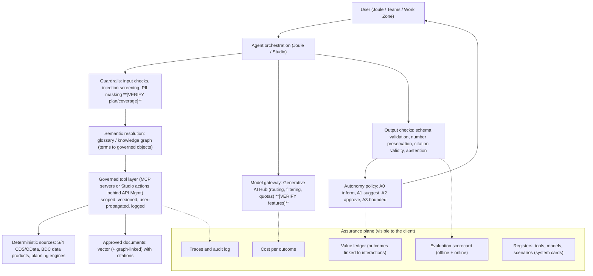

# Trust Stack, Trust Pack and Confidence Ladder (delivery companion)

Companion to `01-confidence-architecture.md` (which explains *why* and what the evidence supports) and `03-scenario-playbook.md` (application per SAP scenario). This file is the *how*: the reference architecture, the artefacts handed to the client, the engagement sequence, and the dev-lead checklist. It merges the design content of the earlier `10-confidence-by-design` draft (archived in `_archive/`).

**Reminder from the evidence:** no controlled enterprise study was found showing that citations, explanations, staged rollout or governance programmes raise adoption or ROI. Every item here is a **hypothesis we test and report on**, not a proven lever. Product statements marked **[VERIFY]** are tracked in `07-sdlc-guide/05-verify-register.md`.

## 1. The Trust Stack (reference architecture)

The **assurance plane** is what clients rarely receive and most need. Budget it as a deliverable (scorecard, registers, dashboards), not as overhead. Controls inside the stack map to `07-sdlc-guide/03-secure-by-design.md`.

## 2. Concepts beyond those in `01` that support confidence

| Concept | Gap addressed | Apply on SAP | Watch-out |
|---|---|---|---|
| Structured outputs and validation | Wrong or unsafe tool calls | JSON-schema outputs validated before any tool call; failures logged and reviewed | Validation passes do not prove the content is right |
| Calibrated LLM-as-judge | Scoring free text at scale | Calibrate against human-scored samples (agreement threshold agreed with client) | Never the sole judge for tier-3 scenarios |
| Provenance and AI-content labelling | Audit, transparency duties | Label AI-drafted text; store prompt, model and version with each generated artefact | Retention and privacy of stored prompts |
| Agent memory governance | Privacy | Explicit scope, retention and erasure path for persistent memory; SAP states Joule memories are private to the user (verify) | Memory can be personal data |
| Caching and small models | Cost | Small models for routing and classification; cache repeated reads | Cache key must include the authorization scope |
| System cards (one page per scenario) | Audit, accountability | Purpose, users, data, models, limits, known failure modes, controls, owner | Version with each release |
| Client-witnessed red-team | Security doubt | Session on the client's own scenarios; share findings and fixes | Disclose failures; hiding them destroys the effect |
| A2A protocols | Cross-vendor agents | Explicit contracts, no production commitment | Not documented on help.sap.com at the time of research [V6] |
| Shadow mode | Accuracy, value, control | Agent runs beside the human process for 4 to 8 weeks, proposes only, results compared with human decisions | Needs a comparable human decision to compare against |
| Champion/challenger | Value | New model or prompt must beat the incumbent on the held-out set | Needs volume and a stable metric |

## 3. The Trust Pack (artefacts delivered with every pilot; refresh at each release)

| Artefact | Content | Owner | Frequency |
|---|---|---|---|
| Evaluation scorecard | Accepted-answer rate, citation validity, refusal correctness, **abstention reported separately from correctness**, variance across 3 runs; by persona, intent, language; method and set size | QA/eval lead | Each release and monthly |
| Bake-off report (if graph proposed) | Four-arm comparison (`01` section 3), per question class | Architect | Once, then on ontology change |
| Persona leakage report | Cross-role tests at every hop, including a denied-access demo | Security engineer | Each release |
| Tool register (template T8) | Every AI-callable capability: owner, data touched, autonomy level, approval, rate limit, last review | Architect | On change |
| Model register | Models, versions, regions, data terms, retirement dates | AI architect | On change |
| System card per scenario (template T9) | See section 2 | Product owner | Each release |
| Trace and audit sample | Redacted end-to-end example for a read and an approved write | Platform lead | Once and on request |
| Red-team summary | Scope, findings, fixes, open items | Security | Before go-live, then yearly |
| Value ledger | KPI vs baseline and control, cost per outcome, benefit classification (`08-value-cases/`) | Value lead and client Finance | Monthly |
| Exit plan | How to swap model, assistant or partner; where prompts, ontology and eval sets live | Architect | Once; test a model swap before go-live |

## 4. The confidence ladder (engagement sequence)

Each step reduces the client's downside before it asks for more commitment. Exit criteria are agreed in advance; stopping is a valid outcome.

| Step | What the client sees | Commitment | Decision at exit |
|---|---|---|---|
| 1 Show on their data | Time-boxed proof on a masked extract or sandbox: 30 to 50 of **their** questions; scorecard published including failures | Low, fixed fee | Proceed to shadow? |
| 2 Shadow mode | Agent runs beside the real process, proposes only; side-by-side with human decisions | Low; no process change | As good as or better than current practice? |
| 3 Assisted (A0/A1) | Users adopt read and suggest features; value ledger starts | Medium | Do adoption and KPI movement justify scale? |
| 4 Approved actions (A2) | Agent prepares transactions; humans approve | Medium to high | Approval rate and error rate within thresholds? |
| 5 Bounded autonomy (A3) | Low-value, reversible actions automated within hard limits | High | Quarterly review |

Approval screens at step 4 must make checking cheap (resolved entities, a diff, a source link). The evidence says explanations raise acceptance regardless of correctness, so track approval time and override rate to detect rubber-stamping (for example approvals in under 5 seconds).

## 5. Dev-lead checklist
- [ ] Client ranked its concerns (`01` section 1); Trust Pack scope agreed
- [ ] Glossary MVP (50 to 150 terms) mapped to CDS views or data products, with owners
- [ ] Semantic resolution step in the agent pipeline; interpretation shown to the user
- [ ] Bake-off designed before the graph is built; graph kept only where it wins
- [ ] Tool register published; MCP or Studio actions with scopes, versions, logging; MCP controls per `03-secure-by-design.md` section 4
- [ ] Deterministic tools for every numeric answer; number-preservation check automated
- [ ] Abstention thresholds calibrated on evaluation data (too many abstentions kill adoption)
- [ ] Shadow-mode design for each write-capable scenario
- [ ] Assurance plane live: traces, scorecard, value ledger, cost per outcome
- [ ] System cards drafted; model register current
- [ ] Client-witnessed red-team scheduled; kill-switch drill scheduled
- [ ] Exit plan written and a model-swap test executed
- [ ] SAP trust claims in client material attributed ("SAP states") with the underlying document requested
