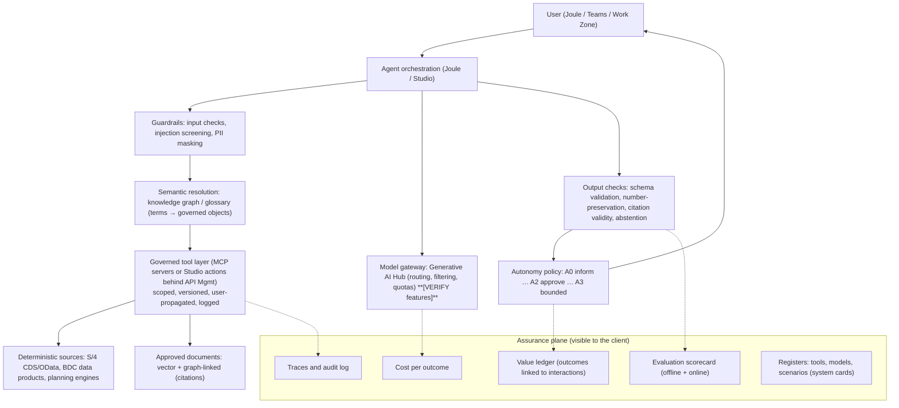

# Confidence by Design: Using Knowledge Graphs, MCP and Related AI Concepts to Earn Client Trust

Status: DRAFT v0.1. Design content. Quantified evidence (e.g. how much a knowledge graph improves answer accuracy) is being sourced into `_research/` and will be cited in `08-value-cases/`; until then this chapter makes **no numeric claims**. Product statements marked **[VERIFY]** are tracked in `07-sdlc-guide/05-verify-register.md`.

---

## 1. Why clients lack confidence, and what actually fixes it

Client hesitation is rarely about "AI" in general. It reduces to seven specific doubts. Each doubt has a technical answer and an *evidence artefact* the client can inspect. **Confidence comes from artefacts the client can verify, not from assurances.**

| # | Client doubt | Underlying question | Technical answer (concepts) | Evidence artefact the client receives |
|---|---|---|---|---|
| C1 | "It will give wrong answers" | Is it accurate on *our* data and *our* questions? | Knowledge graph / semantic layer grounding, deterministic tools, citations, abstention | Evaluation scorecard on their own question bank, re-run every release |
| C2 | "It will expose data" | Does it respect our authorizations and keep data where it should be? | Identity propagation through governed tools (MCP or Studio actions), policy in the graph, classification-based model routing, masking | Persona leakage test report; data-flow diagram; contract clauses |
| C3 | "It will do something we didn't approve" | Who controls actions? | Autonomy levels, approval workflow, tool scopes, dry-run, kill switch | Action catalogue with autonomy level per tool; audit trail sample; kill-switch drill record |
| C4 | "We can't see what it's doing" | Can we audit and explain it? | End-to-end tracing, provenance/lineage, graph paths as explanations | Trace viewer; explanation panel; audit export |
| C5 | "It costs more than it returns" | Will value exceed cost, and when will we know? | Value telemetry linked to transactions, FinOps controls, stage-gated funding, shadow mode | Value ledger; cost-per-outcome dashboard; kill criteria in the charter |
| C6 | "We'll be locked in / it will be obsolete" | Can we change models or vendors? | MCP / open tool interfaces, model abstraction via Generative AI Hub, ontology in open formats | Exit plan; model-swap test result; artefacts in client Git |
| C7 | "Regulators/auditors will object" | Can we prove compliance? | AI inventory, risk tiers, system cards, logging, NIST AI RMF / ISO 42001 alignment | System card per scenario; DPIA; control mapping |

Use this table in the first client workshop: ask the client to rank C1 to C7. The ranking decides which artefacts you build first.

---

## 2. Knowledge graphs as a confidence mechanism

A knowledge graph (KG) or governed semantic layer contributes to confidence in five distinct ways. Design for the ones the client ranked highest.

### 2.1 Accuracy through shared meaning (C1)
LLMs fail on enterprise questions mostly because of **meaning**, not language: which "revenue" (gross, net, recognised), which "plant 1010", which fiscal calendar, which customer hierarchy. A graph/semantic layer defines business concepts once, with their mapping to SAP objects (CDS views, tables, BDC data products), and the agent resolves the user's words to those concepts before any query runs.

Design:
- **Business glossary as graph nodes** (`Metric`, `Dimension`, `BusinessObject`, `Synonym`), each linked to the source CDS view / data product and its owner.
- Agent pipeline: *resolve terms → confirm ambiguity with the user → call a governed query tool with resolved IDs → narrate*. The model never writes free-form SQL against raw tables.
- Show the resolved interpretation in the answer: "Interpreted *net revenue* as KPI `NetRevenue_Recognised` (owner: Group Controlling) for company codes 1010, 1020, fiscal Q3 2026."

### 2.2 Explainability through paths (C4)
Graph traversals produce **human-readable reasons**: "Order 123 is at risk because component C-77 (BOM level 2) is single-sourced from Supplier S-9, whose PO 4500… is confirmed 6 days late." Each hop is a verifiable record. Show the path, with links to the source documents in S/4.

### 2.3 Policy and access as data (C2)
Classification, ownership and access rules attached to graph nodes (e.g. `Customer.margin` → *Confidential, Sales-Finance only*) let the tool layer enforce policy consistently and let the AI explain *why* it refused. Enforcement still happens in the tool/back end using the user's identity; the graph supplies metadata, never a bypass.

### 2.4 Lineage and freshness (C4, C7)
Each answer can carry: source system, object, extraction time, transformation, owner. Stale data is flagged or refused. This answers the auditor's question "where did this number come from?"

### 2.5 Consistency across assistants (C6)
The same semantic definitions serve Joule, SAC, dashboards and third-party copilots, so two tools do not give two different answers to the same question. Inconsistent numbers are one of the fastest ways to lose executive trust.

### 2.6 When *not* to build a graph
- Single-object, single-system questions answered well by a CDS view and a standard Joule capability.
- No owner for ontology maintenance.
- Data quality is the real problem (a graph makes bad data more visible, not better).

Start with a **glossary-plus-mapping MVP** (50 to 150 core business terms for the pilot domain) before any multi-domain ontology. Technology choice by ADR: SAP HANA Cloud graph/knowledge-graph capabilities, BDC/Datasphere semantic models, or a client-standard graph store **[VERIFY SAP options]**.

---

## 3. MCP and the governed tool layer as a confidence mechanism

The Model Context Protocol (MCP) standardises how AI agents discover and call tools. For confidence, the protocol itself matters less than **the discipline it makes enforceable**: every capability the AI can use is a declared, versioned, scoped, logged tool. If MCP is not supported in the client's SAP edition, apply the same discipline with Joule Studio actions behind API Management **[VERIFY SAP MCP status]**.

| Confidence property | How the tool layer delivers it |
|---|---|
| **Bounded capability** (C3) | The agent can do only what is in the tool catalogue. Publish the catalogue to the client: name, purpose, read/write, autonomy level, data touched, owner |
| **Least privilege** (C2) | Per-tool scopes; separate read and write servers; user-propagated tokens; no token passthrough |
| **Auditability** (C4) | Every call logged with user, parameters (masked), result, correlation ID; one format regardless of which assistant called |
| **Reuse = more value per build** (C5) | One governed `get_open_pos` tool serves Joule, Teams/Copilot and a partner agent; build once, consume many |
| **Vendor neutrality** (C6) | Open protocol; the client can switch the assistant or model without rebuilding SAP access |
| **Change control** (C7) | Tool manifests pinned and versioned; descriptions reviewed as code (protects against tool-description poisoning) |

**Confidence artefact:** the *Tool Register*, a client-readable list of every AI-callable capability, reviewed by the client's security team, with a change log. This often settles C3 faster than any presentation.

Security controls for MCP are in `07-sdlc-guide/03-secure-by-design.md` section 4. Do not expose MCP servers to production data without them.

---

## 4. Other AI concepts that build confidence

| Concept | Doubt addressed | How to apply on SAP | Watch-out |
|---|---|---|---|
| **Grounded generation with citations (RAG/GraphRAG)** | C1, C4 | Every factual answer cites S/4 objects or approved documents; GraphRAG links document chunks to graph entities | Citation present ≠ citation correct; evaluate citation validity |
| **Deterministic tools for numbers** | C1 | Amounts, dates, aggregates from CDS/OData/engines; LLM narrates | Check the narration preserves numbers exactly (automated check) |
| **Abstention and confidence signals** | C1 | Agent says "I don't know" when retrieval is weak, entity ambiguous, data stale; route to report or human | Calibrate thresholds on eval data; too many abstentions kill adoption |
| **Structured outputs and validation** | C1, C3 | JSON-schema outputs validated before any tool call | Validation failures logged and reviewed |
| **Evaluation harness (offline + online)** | C1, C5 | Client's own question bank, held-out set, repeat runs, regression on every change | Publish the method, not just the score |
| **LLM-as-judge (calibrated)** | C1 | Scale scoring of free-text answers | Calibrate against human scores; never sole judge for tier 3 |
| **Guardrails / content filtering / PII masking** | C2, C7 | Generative AI Hub orchestration filters and masking where available **[VERIFY]**, plus custom checks | Guardrails are defence in depth, not the primary control |
| **Shadow mode** | C1, C3, C5 | Agent runs alongside the human process, proposes but does not act; compare its proposals to human decisions for 4 to 8 weeks | Strongest single confidence builder before any write action |
| **Champion–challenger and A/B** | C5 | New model/prompt runs on a subset; promote only if better | Needs volume and a stable metric |
| **Human-in-the-loop with autonomy levels** | C3 | A0 to A3 policy (`07-sdlc-guide/01-sdlc-playbook.md`) | Approval fatigue: measure approval time and rubber-stamping |
| **Observability and tracing** | C4 | Correlated traces across Joule → tool → S/4 → model; standard GenAI telemetry conventions where supported **[VERIFY]** | Traces contain sensitive data; protect them |
| **Provenance and AI-content labelling** | C4, C7 | Label AI-drafted text; store prompt/model/version with each generated artefact | Required for some regulations |
| **Model abstraction and routing** | C5, C6 | Generative AI Hub as gateway; route by task, cost, and data class | Re-evaluate on every model change |
| **Small/efficient models + caching** | C5 | Small models for classification/routing; cache safe repeated reads | Cache keys must include authorization scope |
| **Agent memory governance** | C2, C7 | Explicit retention, scope (per-user, per-case), erasure path for any persistent memory | Memory is personal data in many cases |
| **System cards / model cards** | C7 | One page per scenario: purpose, data, models, limits, evaluation, risks, owner | Keep current; version with releases |
| **Red-teaming** | C2, C3 | Client-witnessed red-team session on their scenarios | Share findings and fixes; transparency builds trust |
| **Agent-to-agent (A2A) protocols** | C6 | Cross-vendor agent collaboration with explicit contracts | Emerging; no production commitments until SAP confirms support **[VERIFY]** |

---

## 5. The "Trust Stack": reference architecture

The **assurance plane** is the part clients rarely get and most need. Budget it as a deliverable, not an overhead.

---

## 6. Confidence artefacts: the client "Trust Pack"

Deliver these with every pilot; refresh at each release.

| Artefact | Content | Owner | Frequency |
|---|---|---|---|
| Evaluation scorecard | Accuracy, groundedness, citation validity, refusal correctness, by persona/intent/language; method and set size | QA/eval lead | Each release + monthly |
| Persona leakage report | Results of cross-role tests at every hop | Security engineer | Each release |
| Tool register | Every AI-callable capability with autonomy level | Architect | On change |
| Model register | Models, versions, regions, data terms, retirement dates | AI architect | On change |
| System card per scenario | Purpose, users, data, models, limits, known failure modes, controls, owner | Product owner | Each release |
| Trace and audit sample | Redacted end-to-end example for a read and an approved write | Platform lead | Once + on request |
| Red-team summary | Scope, findings, fixes | Security | Before go-live, then yearly |
| Value ledger | KPI movement vs baseline/control, cost per outcome, benefit classification | Value lead + client finance | Monthly |
| Exit plan | How to swap model, assistant or partner; where artefacts live | Architect | Once |

---

## 7. The confidence ladder (engagement sequence)

Confidence is built in steps that each **reduce the client's downside before they increase commitment**.

| Step | What the client sees | Client commitment | Decision at exit |
|---|---|---|---|
| 1 Show on their data | 2-week proof on a sandbox copy or masked extract: 30 to 50 of *their* questions, scorecard published including failures | Low (fixed fee) | Proceed to shadow? |
| 2 Shadow mode | Agent runs beside the real process, proposes but does not act; side-by-side comparison with human decisions | Low; no process change | Is it as good as or better than current practice? |
| 3 Assisted (A0/A1) | Users adopt read and suggest features; value ledger starts | Medium | Does adoption and KPI movement justify scale? |
| 4 Approved actions (A2) | Agent prepares transactions, humans approve | Medium/high | Approval rate and error rate within thresholds? |
| 5 Bounded autonomy (A3) | Low-value, reversible actions automated within hard limits | High | Quarterly review |

Each step has kill criteria agreed in advance. Publishing failures at step 1 increases credibility. Clients trust a partner who shows where the system is weak.

---

## 8. Confidence KPIs (track and show)

| Dimension | KPI | Target example |
|---|---|---|
| Accuracy | Accepted-answer rate on held-out set; citation validity | Per requirement (e.g. ≥ 90%, ≥ 95%) |
| Honesty | Correct-abstention rate (abstains when it should); false-confidence rate | False confidence trending down release over release |
| Safety | Leakage incidents; injection test pass rate | 0; 100% of critical cases |
| Control | % actions with approval; approval turnaround; rubber-stamp indicator (approvals < 5 s) | Per autonomy policy |
| Transparency | % answers with lineage shown; trace completeness | ≥ 95% |
| Value | KPI delta vs control; cost per outcome vs manual | Positive and stable |
| User trust | Repeat use, thumbs-up rate, "would recommend" score, override rate | Rising; overrides explained |

---

## 9. Objection handling (client conversations)

| Objection | Response built on this chapter |
|---|---|
| "LLMs hallucinate." | "We do not let the model produce facts on its own. Numbers come from your SAP system via governed tools, terms are resolved through a business glossary you own, every answer cites its source, and we'll show you the scorecard on your own questions, including where it fails." |
| "How do we know it respects our roles?" | "The AI calls SAP as you, through tools that check your authorizations. Here is the persona test report from your QA system." |
| "What if it does something wrong?" | "Every capability is in a tool register you approve. Write actions are proposed and approved by a person until the data shows otherwise, and there's a tested kill switch." |
| "We don't want lock-in." | "Tools are exposed through open interfaces, prompts, ontology and evaluation sets live in your Git, and the model sits behind a gateway. We test a model swap before go-live." |
| "Show me the ROI." | "We start in shadow mode with a measured baseline and a control group; the value ledger links outcomes to AI interactions. Funding is staged and each stage has kill criteria." |
| "Our auditors will ask questions." | "Each scenario has a system card, risk tier, DPIA where needed, and full traces. The controls map to NIST AI RMF and ISO/IEC 42001." |

---

## 10. Implementation checklist for dev leads
- [ ] Client ranked doubts C1 to C7; Trust Pack scope agreed
- [ ] Business glossary MVP (50 to 150 terms) mapped to CDS views/data products, with owners
- [ ] Semantic resolution step in the agent pipeline; interpretation shown to user
- [ ] Tool register published; MCP or Studio actions with scopes, versions, logging
- [ ] Deterministic tools for all numeric answers; number-preservation check automated
- [ ] Abstention thresholds calibrated on eval data
- [ ] Shadow-mode design for each write-capable scenario
- [ ] Assurance plane: traces, eval scorecard, value ledger, cost per outcome dashboards
- [ ] System cards drafted; model register current
- [ ] Client-witnessed red-team session scheduled
- [ ] Exit plan written and model-swap test executed
